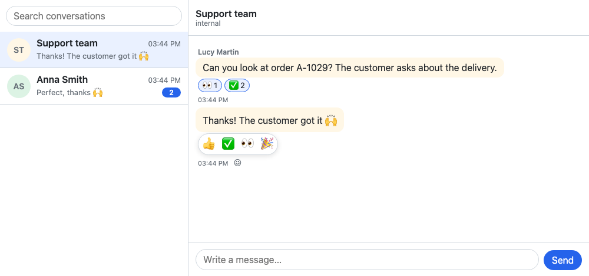
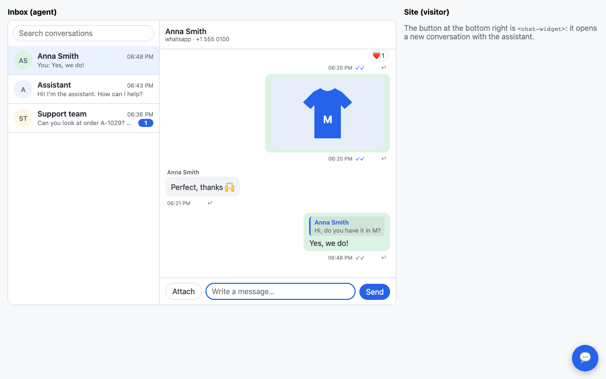

# django-chat-ui

[](https://github.com/rodolvbg/django-chat-ui/actions/workflows/pytest.yml)
[](https://github.com/rodolvbg/django-chat-ui/actions/workflows/js-tests.yml)
[](https://pypi.org/project/django-chat-ui/)
[](https://pypi.org/project/django-chat-ui/)
[](https://pypi.org/project/django-chat-ui/)
[](https://pepy.tech/project/django-chat-ui)

A reusable chat interface — WhatsApp, a chatbot, a company's internal
chat, a "contact us" widget — that speaks [Matrix](https://matrix.org), and
a Django app that is a Matrix homeserver for it.

- [Matrix](docs/protocol.md), the open standard of chat: the components are
  Matrix clients, and the Django app serves the Client-Server API (without
  federation nor end-to-end encryption). A Matrix client or bot — tested
  with the Matrix project's matrix-js-sdk — can use your site; the
  components can use other homeservers. What a business chat needs and Matrix doesn't have — quick
  replies, cards, WhatsApp's templates and 24-hour window, AI answers shown
  as they're written, what each conversation allows — are extensions, in
  Matrix's way: namespaced, with a fallback any other client shows (their
  [JSON Schema](docs/protocol.schema.json)). Yours go the same way.
- `<chat-thread>`: one conversation, its composer following the
  conversation's capabilities (free text, templates only, buttons only,
  closed). Vanilla JS, no build step, safe under a strict Content Security
  Policy.
- `<chat-inbox>`: the inbox of whoever answers — every conversation, the
  latest active first, with unread counts and a search, and the one
  selected; on a narrow screen, the list or the conversation.
- `<chat-widget>`: a site's floating "contact us" chat, which starts a
  conversation when opened (and can remember it, with `storage-key`).
- A Django app: the conversations in the database as Matrix rooms, `/sync`
  with long polling (under ASGI it holds no thread) or polling, media, a
  backend class to decide who chats and what happens, AI agents that speak
  [AG-UI](https://docs.ag-ui.com), and the texts translated (English and
  Spanish).


The same conversation, from the site's widget:


WhatsApp's 24-hour window closed, the composer offers only templates; on a
phone, the inbox shows the list or the conversation; and it follows the
page's dark theme (or the system's):


Reactions, where a conversation allows them (here, only some emojis):



Replies, where a conversation allows them (`"replies": True`): "↩" on a
message answers it, and the answer quotes it (choosing the quote brings
the message into view):



## With Django

```bash
pip install django-chat-ui
```

```python
INSTALLED_APPS = [..., "django_chat_ui"]

urlpatterns = [..., path("chat/", include("django_chat_ui.urls"))]
```

```bash
python manage.py migrate
```

Then, in a template, `` in the `<head>` and the components
wherever they go:

```django

<head>
  …
  
</head>
<body>
  <chat-inbox></chat-inbox>          {# the staff's inbox #}
  <chat-widget heading="Support" subheading="We answer in minutes"
               storage-key="support"></chat-widget>   {# the visitors' #}
</body>
```

`` writes the stylesheet, the configuration (the homeserver's
base URL, the CSRF token, the texts in the request's language) as a JSON
data block, and the module that connects every component of the page.
Nothing inline runs: it works under a strict Content Security Policy.
`` polls every 3 seconds instead of long polling.

A Matrix client or bot can use the site too: its homeserver is
`https://<site>/chat`, and its users log in with their username and password
of the site. What it doesn't know of this package's, it shows as text. (The
tests run matrix-js-sdk against it; clients that require end-to-end
encryption, as Element does by default, aren't supported.)

### Who chats, and what happens

Out of the box, logged-in users chat (staff as agents), each sees the
conversations they take part in, and a conversation started from the
widget goes to every active staff user, `pending` until one answers.
Everything else is a site's to decide, in a subclass of `ChatBackend`:

```python
# myapp/chat.py
from django_chat_ui import services
from django_chat_ui.backend import ChatBackend


class Backend(ChatBackend):
    allow_anonymous = True  # visitors who aren't logged in
    hooks = "thread"  # on_message & co. after the command is answered

    def support_team(self, channel):
        return [self.participant_for_user(user) for user in on_duty()]

    def on_start(self, request, conversation, participant):
        services.system(conversation, "We'll be with you in a minute.")

    def before_send(self, request, conversation, participant, event_type, content):
        if participant.kind == "agent" and conversation.state == "pending":
            services.update_conversation(conversation, state="open")
            services.system(conversation, f"{participant.name} joined")

    def on_message(self, request, message):
        notify_whatsapp(message)  # a RoomEvent: message.body, message.content
```

```python
CHAT_UI = {"BACKEND": "myapp.chat.Backend"}
```

Reactions are off unless a conversation's capabilities turn them on:
`"reactions": True` (any emoji; the interface offers a few), or
`"reactions": {"emojis": ["👍", "✅", "👀"]}` (only those). In
`new_capabilities()` for the conversations it starts, or for any one with
`services.update_conversation(conversation, capabilities={"reactions": True})`.

Its hooks: `get_participant`, `login` (Matrix clients' passwords),
`conversations`, `can_start`, `start`, `support_team`, `new_capabilities`,
`before_send`, `on_start`, `on_message`, `on_action` (a quick reply used:
its answer is in the thread already), `on_event`, `validate_content`,
`serialize_conversation`, `serialize_participant`, and `event_types` for
the events of your extensions.

`on_start`, `on_message`, `on_action` and `on_event` react to a request.
With `hooks = "inline"` (the default) they run inside it; with
`hooks = "thread"`, in a thread of their own once it's committed, so a bot
that takes seconds doesn't hold the message that was sent. For a task
queue (Celery, `django.tasks`), override `run_hook(hook, *args)`.

### Your own models

Conversations and participants can be a site's own models, with its
fields: who a conversation is assigned to, its priority, the company of a
contact. Subclass the abstract ones, and name them in the settings
**before the first `migrate`** (like `AUTH_USER_MODEL`, they can't be
swapped afterwards without migrating the data by hand):

```python
# helpdesk/models.py
from django_chat_ui.models import AbstractConversation, AbstractParticipant


class Ticket(AbstractConversation):
    priority = models.IntegerField(default=1)
    assignee = models.ForeignKey(User, null=True, on_delete=models.SET_NULL)


class Contact(AbstractParticipant):
    company = models.CharField(max_length=200, blank=True)
```

```python
# settings.py
CHAT_UI_CONVERSATION_MODEL = "helpdesk.Ticket"
CHAT_UI_PARTICIPANT_MODEL = "helpdesk.Contact"
```

Both are optional (each defaults to the package's own). The events,
memberships and media stay the package's, pointing to them. In code,
`get_conversation_model()` and `get_participant_model()` (from
`django_chat_ui.models`) give the models in use;
`services.create_conversation(..., priority=2)` fills the fields of yours.
Register them in the admin with `django_chat_ui.admin.ConversationAdmin`
and `ParticipantAdmin`.

For the interface to get your fields, add them in the backend, under
`ext` with your namespace (they go in the room's state):

```python
class Backend(ChatBackend):
    def serialize_conversation(self, conversation, data):
        data["ext"] = {"com.example.helpdesk": {"priority": conversation.priority}}
        return data
```

The example does all this (`example/helpdesk`). Fields that don't need a
column (an id of a CRM, a tag) fit in the `ext` JSON field every model
already has (and `meta`, which stays on the server); and a model of yours
with a `OneToOneField` to the conversation needs no setting at all.

### Integrations: `services`

Bots, webhooks and assignment rules change conversations through
`django_chat_ui.services`, which also tells every open client; the contents
of messages come from `django_chat_ui.content`:

```python
from django_chat_ui import content, services

message = services.send(
    conversation,
    bot,
    content.text("How can I help?", buttons=[{"id": "order", "label": "My order"}]),
)
services.delivered(message, customer)  # WhatsApp's two ticks
services.read(conversation, customer, message)
services.status(message, "failed", {"errcode": "131026", "error": "Undeliverable"})

services.update_conversation(
    conversation,
    capabilities={
        "composer": {
            "mode": "templates",
            "templates": [...],  # WhatsApp's window closed
        }
    },
)
```

`content` has `text` (with `markdown=True`, `buttons=`), `notice`, `system`,
`image`, `video`, `audio`, `file`, `location`, `contact`, `link`, `card` and
`template`. `services` also has `create_conversation`, `add_participant`,
`remove_participant`, `system`, `edit`, `redact`, `react`, `unreact`,
`reactions`, `typing`, and `ephemeral` and `event` for your extensions'.
[docs/protocol.md](docs/protocol.md) maps WhatsApp's messages to them.

### An AI that answers as it writes

Like ChatGPT's: the answer appears in its bubble as the model writes it.
`services.stream_text()` takes the chunks a model streams, shows the text
so far (every 0.1 s or 200 characters: a model's chunks are a few letters
each), and sends the message when they end, or when they fail (with what
came; the error goes on). Other Matrix clients see the bot typing, then its
message:

```python
import anthropic

client = anthropic.Anthropic()


class Backend(ChatBackend):
    hooks = "thread"  # the visitor's message is sent at once; the answer, after

    def on_message(self, request, message):
        if message.sender is None or message.sender.kind == "bot":
            return
        with client.messages.stream(
            model="claude-opus-5-5",
            max_tokens=1024,
            system="You are the assistant of a shop…",
            messages=history(message.conversation),  # your mapping of the messages
        ) as stream:
            services.stream_text(message.conversation, bot, stream.text_stream)
```

`buttons=[...]` adds quick replies after the text, and `markdown=False`
sends it as plain text. For the words to flow rather than jump, read the
log more often: `"POLL_INTERVAL": 0.1`.

An agent of any framework that speaks [AG-UI](https://docs.ag-ui.com)
(LangGraph, CrewAI, Mastra, Pydantic AI, Agno…) answers the same way, with
no code of its own:

```python
from django_chat_ui.agui import AgUiAgent

agent = AgUiAgent("https://agents.example.com/shop", headers={"Authorization": "Bearer …"})


class Backend(ChatBackend):
    hooks = "thread"

    def on_message(self, request, message):
        if message.sender and message.sender.kind != "bot":
            agent.answer(message.conversation, bot)
```

The conversation goes to it as a run (`RunAgentInput`); each text message
it streams back is a message of `bot`. Override `run_input()` to give it
tools, context or state, and `handle()` for its other events (tool calls…).

### Your own kinds of messages and events

Under your namespace, the way this package adds its own (see
[Extending it](docs/protocol.md#9-extending-it)):

```python
services.send(conversation, bot, {
    "msgtype": "com.acme.order",
    "body": "Order A-1029 · 2 items · €59.90",  # what any other client shows
    "com.acme.order": {"id": "A-1029", "total": "59.90"},
})


class Backend(ChatBackend):
    event_types = {"com.acme.order.cancel"}  # what clients may send, besides messages

    def validate_content(self, conversation, participant, event_type, content): ...

    def on_event(self, request, event): ...
```

```js
import { registerMsgtype } from "…/django_chat_ui/content.js";

registerMsgtype("com.acme.order", (content, context) => {
    const card = document.createElement("div");
    card.textContent = `Order ${content["com.acme.order"].id}`;
    return card;
});
```

### Settings

```python
CHAT_UI = {
    "BACKEND": "django_chat_ui.backend.ChatBackend",
    "SERVER_NAME": "localhost",  # the domain of the Matrix IDs (@p3:<it>)
    "SYNC_TIMEOUT": 30,  # seconds a long poll of /sync waits, at most
    "POLL_INTERVAL": 0.5,  # seconds between reads of what's new
    "SETTLE": 1.0,  # seconds an entry missing in the log is waited for
}
```

Set `SERVER_NAME` before the first conversation: it's in every ID. Under
WSGI each long poll holds a worker for up to `SYNC_TIMEOUT`; under ASGI it
waits without a thread. What `/sync` reads is kept in the database for
clients to resume; `python manage.py chat_ui_prune --days 7` deletes the old
entries (run it daily; the conversations stay).

A chat writes from several requests at once. On SQLite, let transactions
take their lock when they start, or two at once fail with "database is
locked" (Django 5.1+):

```python
DATABASES = {"default": {..., "OPTIONS": {"transaction_mode": "IMMEDIATE"}}}
```

## Without Django

The components are Matrix clients: any homeserver works (Synapse,
Conduit…), with a Matrix login's access token. Conversations without this
package's capabilities allow only plain texts.

```html
<link rel="stylesheet" href="…/django_chat_ui/chat.css">
<chat-thread conversation="!room:example.org"></chat-thread>
<script type="module">
  import "…/django_chat_ui/chat-thread.js";
  import { ChatClient } from "…/django_chat_ui/client.js";

  const client = new ChatClient({ baseUrl: "https://matrix.example.org", accessToken });
  document.querySelector("chat-thread").client = client;
  await client.start();
</script>
```

Each takes its texts, to translate them: `element.texts = { send: "Enviar" }`.
Theme them with the `--chat-*` custom properties (on the inbox or the
widget, they reach its thread). Light or dark, they follow the page around
them: Django's admin's theme (`data-theme` on `<html>`), the `dark` class
of Unfold and Tailwind, or else the page's background — and only when the
page says nothing, the system's. A theme switch on the page switches them
too. `data-theme="light"`/`"dark"` on a component fixes its own.

Your own kinds of messages render with `registerMsgtype("com.acme.order",
render)`; any other client shows their `body`.

`homeserver.js` has a Matrix homeserver in memory, scriptable, for tests and
demos (`new ChatClient({ fetch: server.fetch })`).

## Demos

The components alone, on an in-memory homeserver:

```bash
python -m http.server
# open http://localhost:8000/demo/
```

The Django example: a shop with the widget for its visitors (an assistant
greets them, streaming) and an inbox for its staff. With
`ANTHROPIC_API_KEY` set (and `pip install anthropic`), the assistant
answers what visitors write with Claude (`ANTHROPIC_MODEL` to choose
another model); without, it says someone will answer.

```bash
python example/manage.py migrate
python example/manage.py demo_chat     # conversations, and the users admin / demo
python example/manage.py runserver
# http://localhost:8000/ (visitor) and http://localhost:8000/inbox/ (staff)
# ?poll=3000 to poll; under ASGI, where a long poll holds no thread:
uvicorn --app-dir example example.asgi:application
```

## Development

```bash
uv sync
uv run playwright install chromium
npm install                        # vitest, and matrix-js-sdk for a test
uv run pytest                      # Python, with the end-to-end tests
npm test                           # vitest
npx biome check .
```
