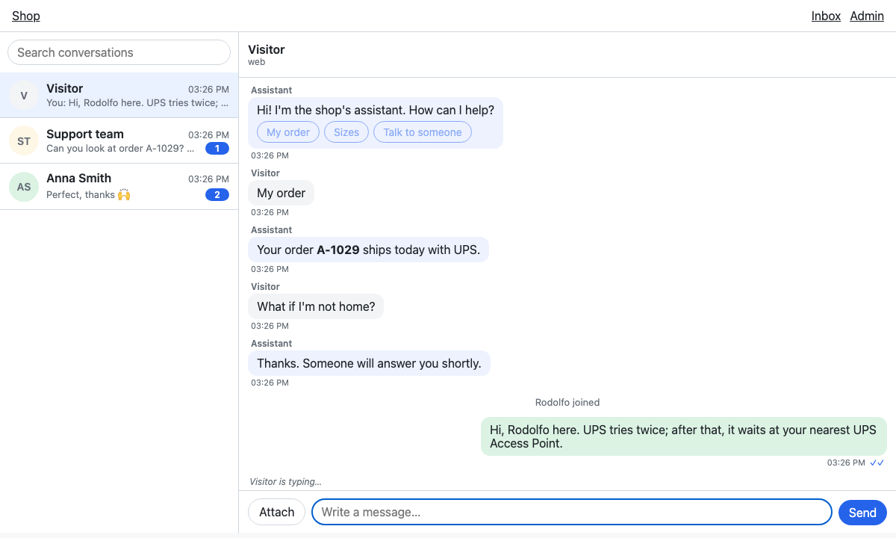
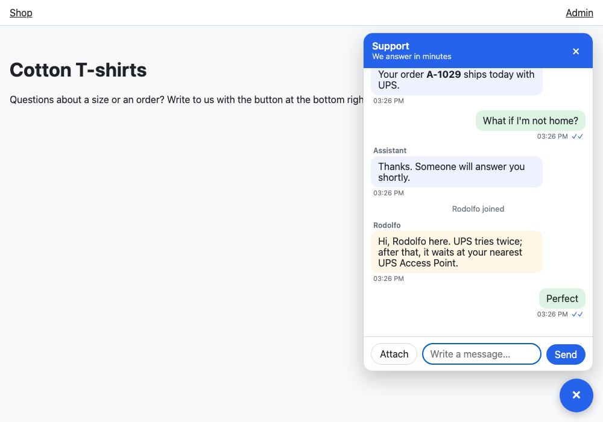
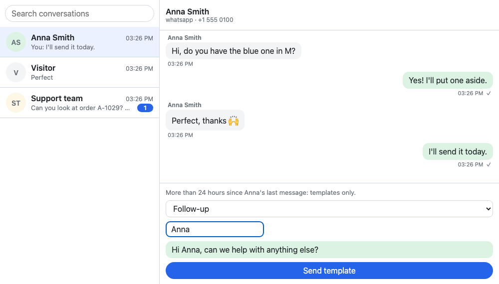
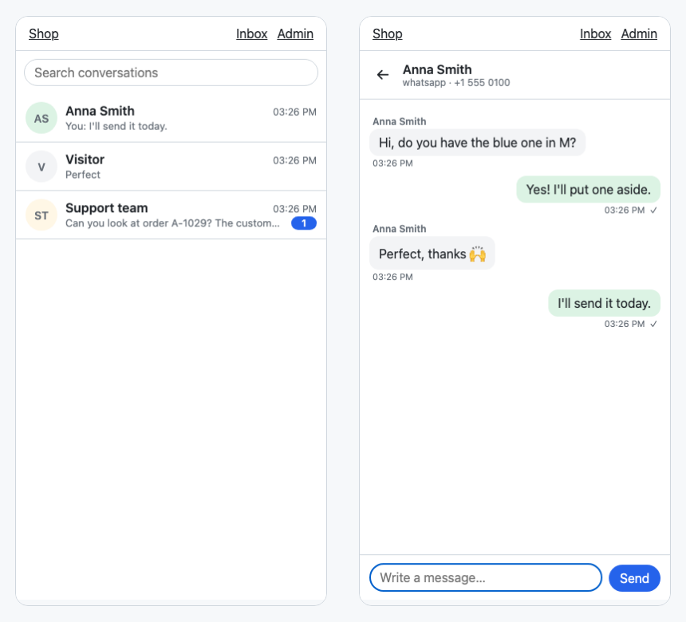
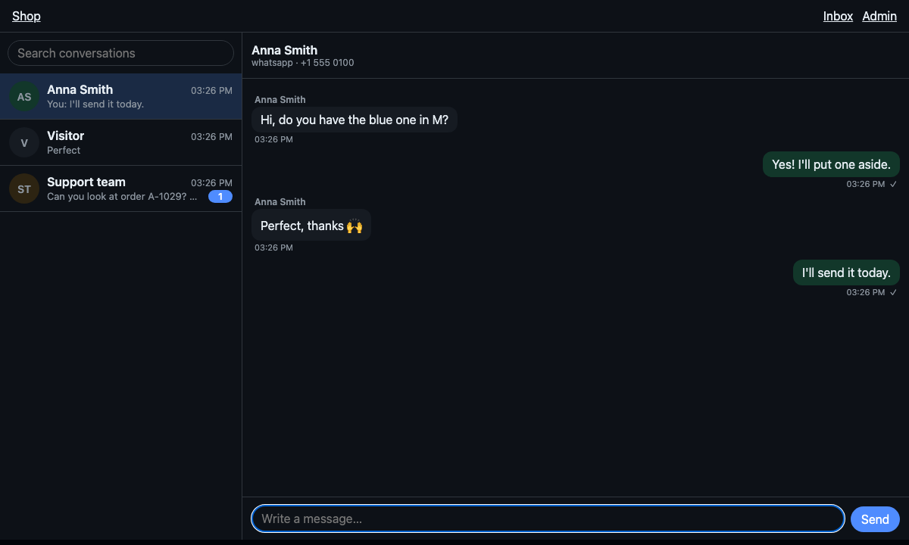

# django-chat-ui

A reusable chat interface — WhatsApp, a chatbot, a company's internal
chat, a "contact us" widget — over one protocol, and a Django backend for
it. Work in progress.

- [The protocol](docs/protocol.md) (and its [JSON Schema](docs/protocol.schema.json)):
  the contract between the interface and any backend, designed to be
  extended.
- `<chat-thread>`: one conversation, its composer following the
  conversation's capabilities (free text, templates only, buttons only,
  closed). Vanilla JS, no build step, safe under a strict Content Security
  Policy.
- `<chat-inbox>`: the inbox of whoever answers — every conversation, the
  latest active first, with unread counts and a search, and the one
  selected; on a narrow screen, the list or the conversation.
- `<chat-widget>`: a site's floating "contact us" chat, which starts a
  conversation when opened (and can remember it, with `storage-key`).
- A Django app: the conversations in the database, the protocol over
  Server-Sent Events and HTTP (or polling), attachments, a backend class to
  decide who chats and what happens, and the texts translated (English and
  Spanish).



The same conversation, from the site's widget:



WhatsApp's 24-hour window closed, the composer offers only templates; on a
phone, the inbox shows the list or the conversation; and it follows the
system's dark mode:







## With Django

```bash
pip install django-chat-ui
```

```python
INSTALLED_APPS = [..., "django_chat_ui"]

urlpatterns = [..., path("chat/", include("django_chat_ui.urls"))]
```

```bash
python manage.py migrate
```

Then, in a template, `` in the `<head>` and the components
wherever they go:

```django

<head>
  …
  
</head>
<body>
  <chat-inbox></chat-inbox>          {# the staff's inbox #}
  <chat-widget heading="Support" subheading="We answer in minutes"
               storage-key="support"></chat-widget>   {# the visitors' #}
</body>
```

`` writes the stylesheet, the configuration (endpoints, CSRF
token, the texts in the request's language) as a JSON data block, and the
module that connects every component of the page. Nothing inline runs: it
works under a strict Content Security Policy. ``
polls instead of keeping a connection open, and `transport="websocket"`
speaks over a WebSocket (below).

The server sends each client what it said it can show (in its `hello`): a
client without cards gets their text, one without markdown plain text, one
that doesn't stream the finished message.

### Who chats, and what happens

Out of the box, logged-in users chat (staff as agents), each sees the
conversations they take part in, and a conversation started from the
widget goes to every active staff user, `pending` until one answers.
Everything else is a site's to decide, in a subclass of `ChatBackend`:

```python
# myapp/chat.py
from django_chat_ui import services
from django_chat_ui.backend import ChatBackend


class Backend(ChatBackend):
    allow_anonymous = True  # visitors who aren't logged in
    hooks = "thread"  # on_message & co. after the command is answered

    def support_team(self, channel):
        return [self.participant_for_user(user) for user in on_duty()]

    def on_start(self, request, conversation, participant):
        services.system(conversation, "We'll be with you in a minute.")

    def before_send(self, request, conversation, participant, parts):
        if participant.kind == "agent" and conversation.state == "pending":
            services.update_conversation(conversation, state="open")
            services.system(conversation, f"{participant.name} joined")

    def on_message(self, request, message):
        notify_whatsapp(message)
```

```python
CHAT_UI = {"BACKEND": "myapp.chat.Backend"}
```

Its hooks: `get_participant`, `conversations`, `can_start`, `start`,
`support_team`, `new_capabilities`, `before_send`, `on_start`,
`on_message`, `on_action`, `validate_parts`, `session_capabilities`, and
`commands` for the commands of extensions.

`on_start`, `on_message` and `on_action` react to a command. With
`hooks = "inline"` (the default) they run inside its request; with
`hooks = "thread"`, in a thread of their own once it's committed, so a bot
that takes seconds doesn't hold the message that was sent. For a task
queue (Celery, `django.tasks`), override `run_hook(hook, *args)`.

### Integrations: `services`

Bots, webhooks and assignment rules change conversations through
`django_chat_ui.services`, which also tells every open interface:

```python
from django_chat_ui import services

message = services.post(conversation, bot, [{"type": "text", "text": "Hi"}])
services.update_message(message, status="delivered")  # a receipt

answer = services.start_stream(conversation, bot)  # a bot writing
services.delta(answer, "Your order ")
services.delta(answer, "ships today.")
services.finish(answer)

services.update_conversation(
    conversation,
    capabilities={
        "composer": {
            "mode": "templates",
            "templates": [...],  # WhatsApp's window closed
        }
    },
)
```

Also `create_conversation`, `add_participant`, `remove_participant`,
`system`, `typing`, `read`, and `emit` for the events of extensions.

### Settings

```python
CHAT_UI = {
    "BACKEND": "django_chat_ui.backend.ChatBackend",
    "STREAM_TIMEOUT": 25,  # seconds a stream lasts (the browser reconnects)
    "POLL_INTERVAL": 0.5,  # seconds between reads of new events
    "KEEPALIVE": 15,  # seconds of silence before a keep-alive comment
    "RETRY": 1000,  # milliseconds the browser waits to reconnect
    "SETTLE": 1.0,  # seconds an event missing in the sequence is waited for
}
```

Under WSGI each open stream holds a worker for up to `STREAM_TIMEOUT`;
under ASGI it waits without a thread. The events are kept in the database
for clients to resume; `python manage.py chat_ui_prune --days 7` deletes
the old ones (run it daily).

A chat writes from several requests at once. On SQLite, let transactions
take their lock when they start, or two at once fail with "database is
locked" (Django 5.1+):

```python
DATABASES = {"default": {..., "OPTIONS": {"transaction_mode": "IMMEDIATE"}}}
```

### WebSocket

With [Channels](https://channels.readthedocs.io/)
(`pip install django-chat-ui[channels]`) and an ASGI server:

```python
# asgi.py
from channels.auth import AuthMiddlewareStack
from channels.routing import ProtocolTypeRouter, URLRouter
from django.core.asgi import get_asgi_application

django_application = get_asgi_application()

from django_chat_ui.routing import websocket_urlpatterns  # noqa: E402

application = ProtocolTypeRouter(
    {
        "http": django_application,
        "websocket": AuthMiddlewareStack(URLRouter(websocket_urlpatterns)),
    }
)
```

and ``. The socket is at `chat/ws`, next
to the app's URLs included at `chat/`; elsewhere, route
`django_chat_ui.consumers.ChatConsumer.as_asgi()` at `<there>/ws`.

## Without Django

The components only speak the protocol: any backend that does works.

```html
<link rel="stylesheet" href="…/django_chat_ui/chat.css">
<chat-thread conversation="conv_1"></chat-thread>
<script type="module">
  import "…/django_chat_ui/chat-thread.js";
  import { ChatClient } from "…/django_chat_ui/client.js";
  import { HttpTransport } from "…/django_chat_ui/transports/http.js";
  // or WebSocketTransport, from transports/websocket.js

  const client = new ChatClient(new HttpTransport({ events: "/chat/events", commands: "/chat/commands" }));
  document.querySelector("chat-thread").client = client;
  await client.connect();
</script>
```

Each takes its texts, to translate them: `element.texts = { send: "Enviar" }`.
Theme them with the `--chat-*` custom properties (on the inbox or the
widget, they reach its thread), or `data-theme="light"`/`"dark"`.

Your own kinds of content render with `registerPart("acme.order", render)`;
any other client shows their `fallback` text.

## Demos

The components alone, on an in-memory server:

```bash
python -m http.server
# open http://localhost:8000/demo/
```

The Django example: a shop with the widget for its visitors (an assistant
greets them, streaming) and an inbox for its staff.

```bash
python example/manage.py migrate
python example/manage.py demo_chat     # conversations, and the users admin / demo
python example/manage.py runserver
# http://localhost:8000/ (visitor) and http://localhost:8000/inbox/ (staff)
# ?transport=polling to poll; over a WebSocket, under ASGI:
uvicorn --app-dir example example.asgi:application
# http://localhost:8000/?transport=websocket
```

## Development

```bash
uv sync
uv run playwright install chromium
uv run pytest                      # Python, with the end-to-end tests
npm install
npm test                           # vitest
npx biome check .
```
